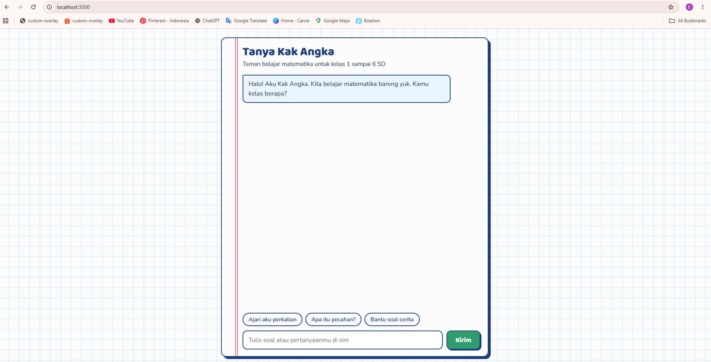
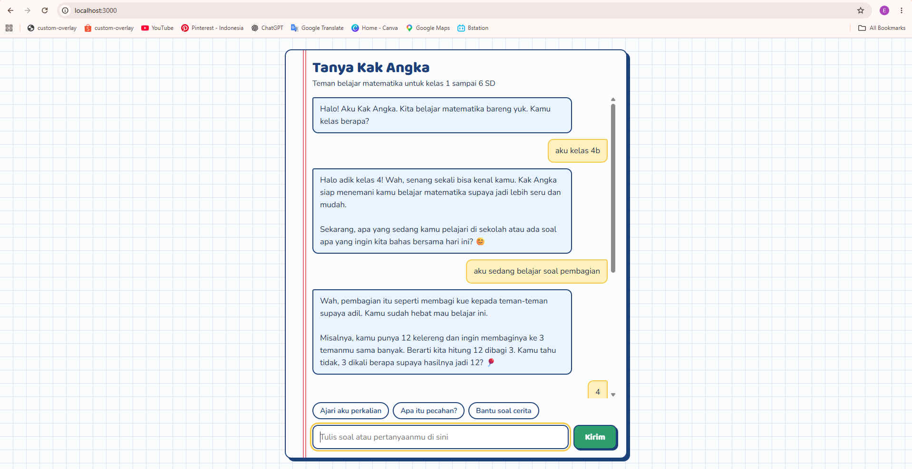

# Kak Angka: Asisten Belajar Matematika untuk Anak SD

Chatbot berbasis web yang menemani anak Sekolah Dasar (kelas 1 sampai 6) belajar matematika. Kak Angka tidak langsung memberi jawaban akhir, tetapi membimbing langkah demi langkah dengan bahasa sederhana dan contoh sehari-hari.

Proyek ini dibuat sebagai tugas akhir Sesi 3 program **AI Productivity and AI API Integration for Developers** (Hacktiv8), memakai Google Gemini API.

## Screenshot





## Fitur

- Percakapan multi-turn: Kak Angka mengingat pesan-pesan sebelumnya dalam satu sesi.
- Persona ramah anak: bahasa Indonesia sederhana, sabar, dan memakai contoh seperti jajan, kelereng, atau kue.
- Metode membimbing: memberi petunjuk, bukan langsung jawaban; jawaban anak yang keliru dikoreksi dengan lembut.
- Dibatasi hanya untuk matematika dan belajar, serta tidak menanyakan data pribadi anak.
- Tombol saran untuk memulai percakapan.
- Tampilan bertema buku tulis kotak-kotak, responsif di ponsel.

## Teknologi

- **Backend:** Node.js, Express, `@google/genai`, `cors`, `dotenv`, `multer`
- **Frontend:** HTML, CSS, dan JavaScript murni (Vanilla JS)
- **Model AI:** Google Gemini (diatur lewat konstanta `CHAT_MODEL` di `index.js`)

## Struktur Folder

```
tugas-final/
├── public/
│   ├── index.html
│   ├── script.js
│   └── style.css
├── .env              (tidak ikut di-commit)
├── .gitignore
├── index.js
├── package.json
└── README.md
```

## Cara Menjalankan

### 1. Prasyarat

- Node.js (disarankan versi LTS terbaru)
- Gemini API key dari [Google AI Studio](https://aistudio.google.com/)

### 2. Instalasi

```bash
git clone https://github.com/USERNAME/NAMA-REPO.git
cd NAMA-REPO
npm install
```

### 3. Siapkan file `.env`

Buat file `.env` di folder utama proyek:

```
GEMINI_API_KEY=isi_api_key_kamu
```

File `.env` sudah dimasukkan ke `.gitignore`, jadi API key tidak ikut terunggah ke GitHub.

### 4. Jalankan server

```bash
node index.js
```

Buka **http://localhost:3000** di browser. Jangan membuka `index.html` langsung dari folder, karena frontend membutuhkan server untuk memanggil API.

## Endpoint API

### `POST /api/chat`

Mengirim riwayat percakapan dan menerima jawaban dari Gemini.

Request:

```json
{
  "conversation": [
    { "role": "user", "text": "Aku kelas 4. Ajari pecahan dong" },
    { "role": "model", "text": "Halo! Coba bayangkan satu martabak dipotong 4 bagian..." },
    { "role": "user", "text": "Jadi 1/4 ya?" }
  ]
}
```

Response berhasil (`200`):

```json
{ "result": "Betul sekali! ..." }
```

Response gagal: `400` jika format `conversation` tidak valid, `500` jika terjadi kesalahan di server.

Catatan: `role` hanya boleh `user` atau `model`.

### Endpoint lain

- `POST /api/generate-text`: menghasilkan teks dari satu `prompt`.
- `POST /api/process-media`: menerima `prompt` dan satu `file` (gambar, audio, video, atau dokumen, maksimal 1 MB) untuk dianalisis.

## Konfigurasi Gemini

| Pengaturan | Nilai | Alasan |
|---|---|---|
| `temperature` | 0.4 | Rendah agar hitungan lebih konsisten, tetapi penjelasan tetap luwes |
| `topP` | 0.9 | Membatasi pilihan kata agar jawaban tetap fokus |
| `systemInstruction` | Persona "Kak Angka" | Mengatur gaya bicara, cara mengajar, dan batasan topik |

System instruction lengkap ada di konstanta `SYSTEM_INSTRUCTION` pada `index.js`.

## Catatan

- Jawaban AI bisa saja keliru, termasuk dalam hitungan. Orang tua atau guru sebaiknya tetap mendampingi anak.
- Jangan pernah meng-commit file `.env` atau membagikan API key.
